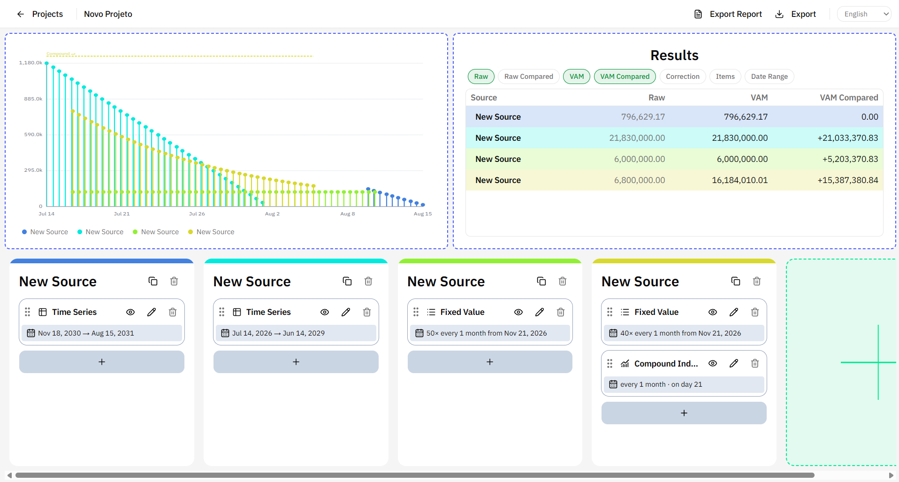

# financ

[](https://github.com/rochaenrique/financ/actions/workflows/ci.yml)
[](LICENSE)

**The quickest way to calculate and compare a bank proposal.**

Paste in a proposal, drop its payment schedule in from a PDF, add the interest or inflation that applies, and see what it actually costs, side by side with the other offers on the table.

**[Try it live](https://financ-xi.vercel.app)** · runs entirely in your browser, no account needed.



## Why financ

Comparing financing offers usually means retyping a PDF amortization schedule into a spreadsheet, wiring up interest formulas, and hoping nothing slipped. financ is built around removing that friction:

- **Speed first.** Every flow is designed to get you from "I have a proposal" to "I know what it costs" in as few steps as possible.
- **Usability over configurability.** Adding a value, a compounding rate, or a whole payment schedule is a couple of clicks, with sensible defaults, live previews, and a keyboard flow for typing in tables by hand.
- **No retyping.** A custom PDF table parser reads the schedule straight out of the bank's document.

## Features

### Build a proposal quickly

A **project** holds one or more **sources** (for example, one per bank offer), and each source is a stack of **items**:

| Item | What it models |
| --- | --- |
| **Time Series** | Dated values, imported from a PDF table or typed into a table editor |
| **Fixed Value** | A constant amount applied on a schedule |
| **Simple Index** | A non-compounding rate applied over a schedule |
| **Compound Index** | A single rate that compounds over a repeating schedule |
| **Index Series** | A researched index (inflation, for example) entered as dated readings, used to correct the other items in the source |

Schedules are flexible: *N times starting on a date*, *every interval over a date range*, or *every interval for the entire time*, in days, weeks, months, or years. Dates can also follow the source's own start and end, so a schedule re-resolves automatically as the data changes. Duplicate a source to try a variation, or disable an item to see its effect disappear.

### Interest and index calculation

Each source reports both its **Raw** total (the values exactly as entered) and its corrected total (**VAM**) after every applicable simple, compound, and series index has been applied. Indices can settle values forward to the future or back to the present. Results are compared against the cheapest source, in a sortable table with toggleable columns and a chart that shows every point and the span each index covers.

### PDF table import

Bank documents rarely come in a friendly format, so financ includes its own table extractor built on top of [pdf.js](https://mozilla.github.io/pdf.js/):

- Reads the page's drawing operations to find the table's **real gridlines**, the most reliable signal of where columns and rows are.
- Falls back to **text-position clustering** when a table has no visible borders, and separates tables from surrounding prose.
- **Joins tables that continue across pages**, matching columns by physical position rather than by header text.
- Lets you pick the date column and the value columns, and checks the selection before importing anything.

PDFs are parsed in your browser and never uploaded anywhere.

### Export a report

Generate a PDF report with the summary table, a chart, and a per-source breakdown. Choose which sources and columns to include, pick a currency, and optionally add a table of contents. Charts are drawn as vector graphics, so they stay sharp at any size.

### Private by design

There is no backend, database, or account. Projects live in your browser's local storage, and can be exported to and imported from JSON files to move between machines or keep backups.

### Multilingual

The interface is available in **English, Spanish, and Portuguese**, selected from the URL (`/en`, `/es`, `/pt`) and remembered between visits. Numbers and dates follow the selected language's conventions, including in exported reports.

## Getting started

Requires [Node.js](https://nodejs.org) 20.9 or newer.

```bash
git clone https://github.com/rochaenrique/financ.git
cd financ
npm install
npm run dev
```

Open [http://localhost:3000](http://localhost:3000). You will be redirected to a language based on your browser's preferences.

| Script | What it does |
| --- | --- |
| `npm run dev` | Start the development server |
| `npm run build` | Create a production build |
| `npm start` | Serve the production build |
| `npm run lint` | Run ESLint |
| `npm run typecheck` | Type-check the whole project |
| `npm test` | Run the unit tests |
| `npm run test:coverage` | Run the unit tests with a coverage report |
| `npm run test:e2e` | Run the end-to-end tests |

## Tech stack

- [Next.js](https://nextjs.org) 16 (App Router) and [React](https://react.dev) 19, in TypeScript
- [Tailwind CSS](https://tailwindcss.com) 4, with [Base UI](https://base-ui.com) and [shadcn/ui](https://ui.shadcn.com) components
- [pdf.js](https://mozilla.github.io/pdf.js/) for reading PDFs
- [jsPDF](https://github.com/parallax/jsPDF) and [jspdf-autotable](https://github.com/simonbengtsson/jsPDF-AutoTable) for report export
- [next-intl](https://next-intl.dev) for translations and locale-aware formatting

## Testing

Calculation mistakes are expensive in a tool people use to compare loans, so the logic that produces the numbers is tested directly, and the main user flows are tested end to end.

```bash
npm test                # unit tests (Vitest), runs in a couple of seconds
npm run test:coverage   # the same, with a coverage report for src/lib
npx playwright install chromium   # once, to download the test browser
npm run test:e2e        # end-to-end tests (Playwright), builds and serves the app itself
```

**Unit tests** (`src/**/*.test.ts`) check the calculations against results worked out by hand rather than against the implementation. For example, 1,000 compounded at 1% per day for 10 days has to equal `1000 × 1.01¹⁰`. They cover index correction (compound, simple, and index series, settling forward and back), schedule expansion and date references, number and date parsing from PDFs (`15/03/2024`, `1.234,56`), project storage and JSON export/import, the results table math, chart geometry, the PDF-to-items converter, and the PDF report generator.

**Locale parity test** (`src/i18n/messages.test.ts`) makes sure English, Spanish, and Portuguese have exactly the same keys, valid message syntax, and matching placeholders, and that every message key used in the code exists.

**End-to-end tests** (`e2e/`) drive the production build in a real browser: language detection and persistence, building a proposal and reading its totals, disabling and duplicating items, a JSON export and import round trip, and downloading the PDF report. They only touch the browser's own storage, so they can also be pointed at a deployed copy:

```bash
E2E_BASE_URL=https://your-deployment.example.com npm run test:e2e
```

**Not covered yet:** the PDF table parser itself (`src/lib/pdf-import.ts`), which needs pdf.js running in a browser, so it is excluded from the coverage report rather than counted as tested.

### Continuous integration

[GitHub Actions](.github/workflows/ci.yml) runs on every push to `main` and every pull request. One job runs lint, type-check, the unit tests with coverage, and a production build. A second job runs the end-to-end suite in Chromium and uploads the Playwright report if anything fails.

## Project structure

```
e2e/                 End-to-end tests (Playwright)
messages/            Translations, one JSON file per language
src/
  app/[locale]/      Pages: project list and project editor
  components/        UI, including the add-item wizard and PDF import dialog
  i18n/              Locale routing and navigation helpers
  lib/
    pdf-import.ts    PDF table extraction
    valuation.ts     Schedules, index correction, and totals
    results.ts       Per-source results shown in the table and report
    pdf-report.ts    PDF report generation
    *.test.ts        Unit tests, next to the code they cover
  test/              Shared test helpers and fixtures
  proxy.ts           Locale detection and redirects
.github/workflows/   CI
```

## Adding a language

1. Copy `messages/en.json` to `messages/<code>.json` and translate it.
2. Add the code to `locales` in `src/i18n/routing.ts`.
3. Add its display name to `LOCALE_LABEL` in `src/components/project/language-switcher.tsx`.

The PDF report uses built-in Latin fonts, so languages written in other scripts would also need an embedded font in `src/lib/pdf-report.ts`.

## License

Copyright (C) 2026 Enrique Rocha Benatti

financ is free software, licensed under the [GNU Affero General Public License v3.0](LICENSE) (`AGPL-3.0-only`). You are free to use, study, modify, and share it. If you distribute a modified version, or run one as a network service that others interact with, you must make your complete source available to those users under the same license.

Third-party dependencies are covered by their own licenses.

## Disclaimer

financ is a calculation aid for comparing proposals and is not financial advice. Verify any figures with the lender before making a decision.
